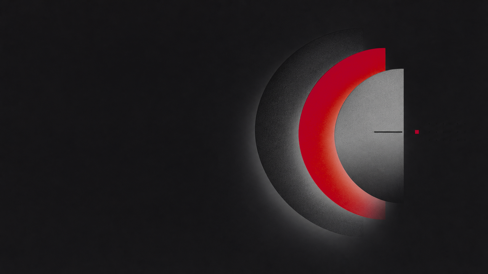

# Panacea Dark — Omarchy theme

A dark, Nothing-style Omarchy theme based on [EnsixD/Panacea](https://github.com/EnsixD/Panacea):
charcoal surfaces, soft grey text, one signal red (`#d71921`), dot-matrix numerals.



## Install

```bash
omarchy theme install https://github.com/idealgeek007/omarchy-panacea-dark-theme
```

That gives you the colours, wallpapers, icons and the Nothing-style shell
(menus, launcher, notifications, lock screen).

### Extras (recommended)

Omarchy themes can't ship code, so the rest lives in `extras/`:

```bash
~/.config/omarchy/themes/panacea-dark/extras/install.sh
```

| Extra | What you get |
|---|---|
| `plugins/panacea.clock` | Dot-matrix bar clock; calendar with a dot-matrix date, red "today" disc and a Nothing-style year dot bar |
| `plugins/panacea.workspaces` | Workspace dots: red pill = focused, white = occupied, dim = empty |
| `plugins/panacea.system-stats` | CPU / RAM with dim labels and dot-matrix values that turn red past 85% |
| `hypr/panacea-dark.lua` | Panacea animations, red→white borders, 12px corners (only while this theme is active; respects the no-gaps toggle) |
| `fish/` | Panacea pill prompt `▍dir  branch*  ⟢` and syntax colours read live from the active theme |
| `fastfetch/` | Red logo and keys, dot bullets |
| `hooks/code-oss-theme.hook` | Syncs the theme into Code - OSS (Arch's `code`), which Omarchy skips |
| `fonts/Doto-ExtraBold.ttf` | [Doto](https://github.com/oliverlalan/Doto), SIL OFL 1.1 |

The installer backs up anything it replaces as `*.bak.<timestamp>`.

## Credits

Look and wallpapers derived from [EnsixD/Panacea](https://github.com/EnsixD/Panacea) (MIT),
inverted to dark. Doto font © The Doto Project Authors, SIL OFL 1.1.
